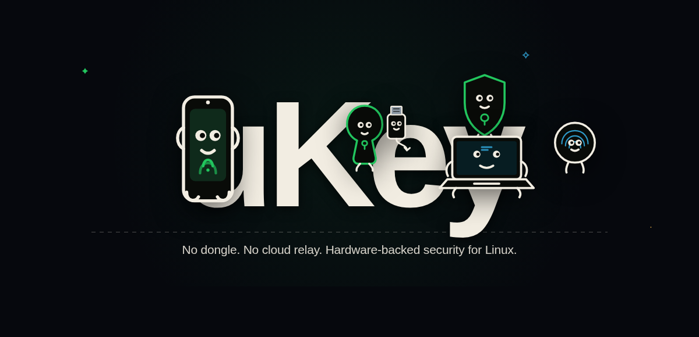

<div align="center">



<br />

### Your Android phone, as a virtual FIDO2 security key for Linux

An open-source authenticator: a Python daemon creates a USB-style HID security key through `/dev/uhid`, while an Android app keeps the P-256 key inside AndroidKeyStore and approves signatures with a biometric fingerprint prompt.

<br />

<p align="center">
  <a href="https://docs.kernel.org/hid/uhid.html"></a>
  <a href="https://developer.android.com/privacy-and-security/keystore"></a>
  <a href="https://fidoalliance.org/specs/fido-v2.0-ps-20190130/fido-client-to-authenticator-protocol-v2.0-ps-20190130.html"></a>
  <a href="https://github.com/siddharthsai218/ukey/actions"></a>
  <a href="https://www.gnu.org/licenses/gpl-3.0"></a>
</p>

**[Website](https://siddharthsai218.github.io/ukey/)** · **[Architecture](ARCHITECTURE.md)** · **[Status](docs/STATUS.md)** · **[Security Policy](SECURITY.md)** · **[Quickstart](#quickstart)**

</div>

---

## What works today

| Area | State | Evidence |
|---|---|---|
| UHID virtual device | **Working** | `fido2-token -L` / `-I` show a `FIDO_2_0` token on a `/dev/hidraw` node |
| CTAPHID framing | **Working** | `tests/test_phase1.py`; INIT, PING, CBOR, CANCEL, KEEPALIVE, fragmentation |
| CTAP2 `getInfo` | **Working** | Python tests; `fido2-token -I` |
| CTAP2 `makeCredential` | **Working** | Python tests; `fido2-cred -M` / `-V`; non-resident, packed self-attestation |
| CTAP2 `getAssertion` | **Working** | Python tests; `fido2-assert -G` / `-V`; ES256 |
| Phone pairing | **Working** | `tests/test_pairing.py`; one-time 6-digit PIN, 256-bit device token, lockout, revoke |
| Android signer | **Working** | Kotlin source and unit tests; StrongBox preferred, TEE fallback |
| Credential metadata | **Working** | `~/.config/ukey/credentials.json`; credential ID, RP ID, public key |
| Local controls | **Working** | `ukeyctl` menu/status/config/doctor; dashboard on `127.0.0.1:8444` |
| Auto-lock | **Opt-in** | `tests/test_auto_lock.py`; proximity session lock |
| Fedora installer | **Verified** | `install.sh`; verified on Fedora 43 with systemd user service |

## Development Status & Roadmap

- **Host Workflows:** End-to-end testing for browser WebAuthn and OpenSSH `ecdsa-sk` key workflows is actively underway.
- **CTAP1 / PAM:** Backward-compatibility layer for PAM/sudo login is in active development.
- **Protocol Depth:** Discoverable (resident) credentials (`rk=true`) and mutual handshake authentication are actively being developed.
- See [`docs/STATUS.md`](docs/STATUS.md) for the live ledger of every feature and test.

---

## Quickstart

The verified path is a Fedora machine with `/dev/uhid`, Python 3.10–3.12, and libfido2 installed.

```bash
git clone https://github.com/siddharthsai218/ukey.git
cd ukey
./install.sh
```

`install.sh` asks for `sudo` to install the udev rule. It creates a Python virtual environment and a systemd **user** service, then starts it with safe defaults: signer bridge on `127.0.0.1:8443`, wireless off, auto-lock off.

Verify that the kernel sees the token:

```bash
fido2-token -L
fido2-token -I /dev/hidraw6   # use the node printed by -L
```

Expected: a hidraw node and `FIDO_2_0` / `ES256` details. The node number is assigned by the kernel and may differ.

### Other distributions

The installer has package branches for Fedora, Debian/Ubuntu, Arch, and openSUSE. On other distributions, install `libfido2` and `python3-venv`, run `./setup_udev.sh`, create the virtual environment, and start the daemon.

---

## Pair an Android phone

Build and install the app from `android/` with Gradle, then connect it over USB:

```bash
adb reverse tcp:8443 tcp:8443
./scripts/ukeyctl pair
```

Enter the one-time 6-digit PIN shown by `ukeyctl pair` in the app. Pairing returns a 256-bit device token that the phone stores for subsequent connections. The PIN is single-use, rotates when requested, and is invalidated after five failed attempts. `./scripts/ukeyctl devices` lists paired phones and allows one-click revocation.

### Local controls

```bash
./scripts/ukeyctl status
./scripts/ukeyctl doctor
./scripts/ukeyctl menu          # interactive terminal control center
./scripts/ukeyctl web           # http://127.0.0.1:8444
```

The dashboard and CLI bind to loopback. They can toggle biometric interception, show a pairing PIN, list/revoke devices, and inspect daemon status.

---

## Architecture

```
Linux host
  libfido2 / fido2-*  ──►  /dev/hidrawN  ◄──  Linux kernel /dev/uhid
                                                    ▲
                                                    │ HID reports
                                      uKey Python daemon
                                        ├─ CTAPHID framing
                                        ├─ CTAP2 engine
                                        ├─ credential metadata
                                        ├─ pairing manager
                                        ├─ signer bridge (TCP :8443)
                                        └─ local dashboard (:8444)
                                                    ▲
                                                    │ local loopback (adb reverse)
                                                    ▼
                                      Android app (hardware signer)
                                        ├─ pairing / token auth
                                        ├─ BiometricPrompt
                                        └─ AndroidKeyStore P-256 key
                                             ├─ StrongBox preferred
                                             └─ TEE fallback
```

The daemon owns no private keys. It asks the signer to sign; the phone gates that operation behind a biometric prompt and keeps the key inside AndroidKeyStore.

---

## Tests

```bash
.venv/bin/python -m unittest discover -s tests -v
.venv/bin/python -m py_compile daemon/*.py scripts/ukeyctl
bash -n install.sh setup_udev.sh scripts/setup_pam_sudo.sh
```

39 tests currently pass. Coverage includes CTAPHID framing, CBOR canonicalization, CTAP2 make/assert, configuration validation, auto-lock behavior, pairing/token auth, and the signer bridge. CI runs Python 3.10–3.12 plus shell and systemd syntax checks.

---

## Security Architecture

uKey is designed local-first with defense in depth:

- **Hardware Key Isolation:** P-256 private keys are generated inside Android's hardware keystore (`AndroidKeyStore`) with StrongBox / TEE backing. Software keys are rejected. Keys never leave physical silicon.
- **Biometric Presence:** Every assertion requires physical `BiometricPrompt` authorization on the phone.
- **Local Loopback Transport:** Default binding to `127.0.0.1` via `adb reverse`. Zero cloud dependence and zero external telemetry.
- **Safe Defaults:** Config file stored with `0600` permissions in `~/.config/ukey/`.

Read [`SECURITY.md`](SECURITY.md) for full architectural details.

---

## License

GPL-3.0. See [`LICENSE`](LICENSE).

Developed by **BYN Siddharth Sai**.
